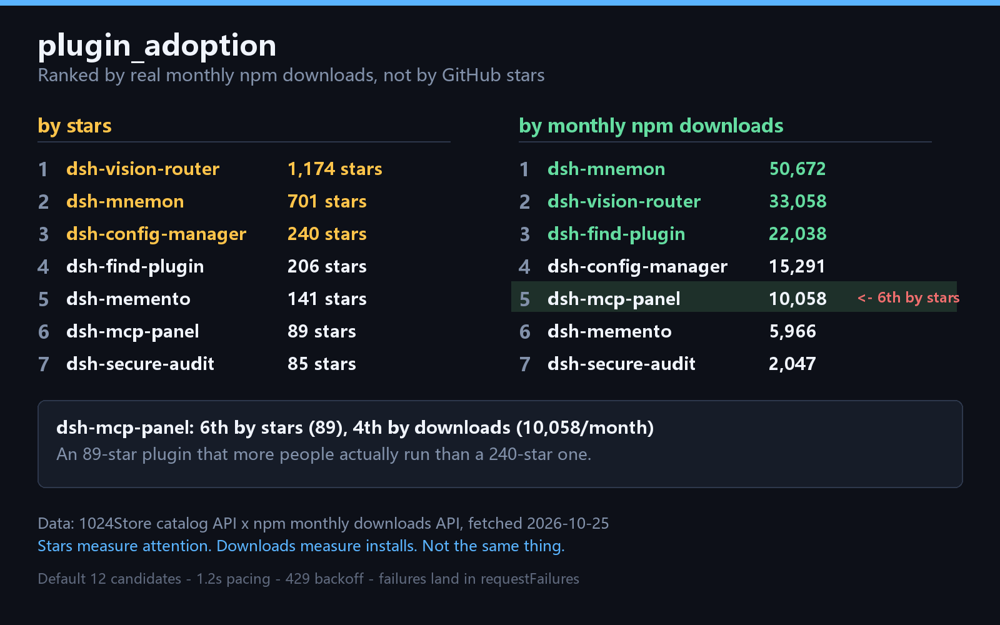

# dsh-plugin-adoption

Rank DSH plugins by **real monthly npm downloads** instead of GitHub stars.

[](https://deepseek1024.com/)
[](https://github.com/Anguis-L/dsh-plugin-adoption/actions/workflows/ci.yml)

> 中文说明见 [README.zh.md](README.zh.md)。

## Install

**Recommended** — this form is counted by 1024Store's install analytics:

```bash
dsh plugin --profile <your-profile> add github:Anguis-L/dsh-plugin-adoption
```

Version **v0.1.0**. Restart `dsh` once after installing (the bundle layer is
assembled at startup), then ask the agent to call `plugin_adoption`.

## Why this exists

Community discovery surfaces order by **GitHub stars**. But a star measures the
attention a repository got, not an install that happened. Measured against the
live catalog on 2026-10-25:



```
by stars:     vision-router(1174) > mnemon(701) > config-manager(240)
              > find-plugin(206) > memento(141) > mcp-panel(89) > secure-audit(85)

by downloads: mnemon(50,672) > vision-router(33,058) > find-plugin(22,038)
              > config-manager(15,291) > mcp-panel(10,058) > memento(5,966)
              > secure-audit(2,047)
```

`dsh-mcp-panel` is **6th by stars (89) but 4th by downloads (10,058/month)** —
an 89-star plugin that more people actually run than a 240-star one.

**Stars can mislead; downloads don't.** This plugin puts both orderings side by
side and flags what star ordering under-rates.

## Usage

```
plugin_adoption()                                 # default: query "dsh", 12 candidates
plugin_adoption({ queries: ['memory', 'tool'] })  # union of several searches
plugin_adoption({ limit: 30 })                    # more candidates (slower, costs quota)
plugin_adoption({ topN: 20 })                     # return the top 20
```

## Output

```jsonc
{
  "sampled": 12,               // candidates found
  "withPackage": 9,            // that have an npm package
  "withDownloads": 9,          // both numbers available, comparable
  "topByDownloads": [
    { "name": "dsh-mnemon", "downloads": 50672, "stars": 701,
      "starRank": 2, "downloadRank": 1 }
  ],
  "underratedByStars": [       // shift > 0
    { "name": "dsh-mcp-panel", "stars": 89, "downloads": 10058,
      "starRank": 6, "downloadRank": 5, "shift": 1 }
  ],
  "noPackage": ["owner/repo"], // no npm package; listed, never treated as 0
  "requestFailures": [],       // every request failure, never silent
  "sources": { "catalog": "...", "npm": "...", "fetchedAt": "..." }
}
```

`shift = starRank - downloadRank`. Positive means downloads rank it higher than
stars do.

## About quota (important)

The 1024Store catalog API is anonymous at **50 requests/day, 10/minute** (its
own docs). One default run = 1 catalog call + at most 12 npm calls.

So this plugin:

- Samples **12 candidates by default**, so a first run cannot exhaust your day
- Paces requests **1.2s apart**, never bursted
- **Backs off on 429** (5s / 15s / 45s), then reports — never spins
- Retries once on **timeout**; does not retry DNS or connection failures
- Writes **every failure into `requestFailures`** — a network fault must not
  render as "0 plugins"

That last one is the design principle: **a report that says "0 plugins" when the
network actually failed is more dangerous than one that says "I could not tell"**,
because the first reads as a finding.

## Data sources

| Data | Source |
|---|---|
| Plugin list, stars, install counts | `api.deepseek1024.com/v1/plugins/search` |
| Monthly downloads | `api.npmjs.org/downloads/point/last-month/<pkg>` |

Both are public read-only endpoints. No authentication.

## Limitations

- **Plugins without an npm package cannot be compared**; they are listed under
  `noPackage` — "not published" and "nobody downloaded it" are different facts.
- Stars come from a catalog snapshot; downloads are npm's current-month window.
  The two time windows differ.
- Downloads include CI, mirrors, and automated installs — not purely "humans using it".
- Sampling depends on `queries`; it is not the full catalog.

## Development

```bash
node --check index.js && node --check lib/adoption.mjs   # syntax
node --test test/logic.test.mjs                          # offline logic tests
```

The tests are **offline on purpose**: running them against the live API would
spend the caller's 50/day anonymous quota, which is exactly what this plugin
exists to avoid.

## Related

[dsh-plugin-trust-audit](https://github.com/Anguis-L/dsh-plugin-trust-audit) —
audit whether DSH plugin HTTP routes are actually fenced.

## License

MIT
