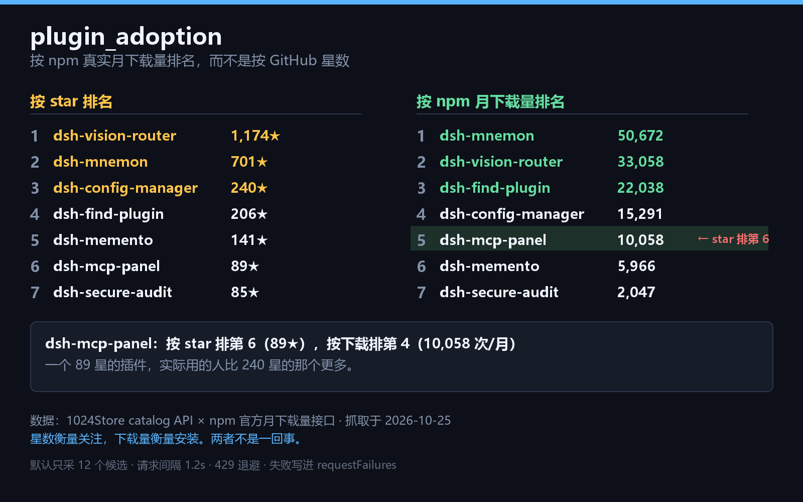

# dsh-plugin-adoption


> English: [README.md](README.md).

按**真实 npm 月下载量**给 DSH 插件排名，而不是按 GitHub 星数。
同时带两个独立维度：**能力面风险（C0–C3）** 和 **版本线（装不装得上）**。

[](https://deepseek1024.com/)

## 它做什么、不做什么

本插件**只读**公开数据源，并对读到的内容**排序**。它不写任何东西、不安装、
不修改、也不限制任何东西。

| | |
|---|---|
| 读取 | 1024Store catalog 公开接口（只读）、npm registry / 下载量接口（只读）、dsh-xray 能力面快照（只读）|
| 写入 | **无** —— 不写文件、不改配置、不改 registry 状态、不动其它插件 |
| 网络 | 只发 GET，去公开接口、npm registry 和 dsh-xray |
| 注册 | 一个工具 `plugin_adoption`，自身不注册 HTTP 路由 |
| 改动其它插件 | **从不**。它只报告排名，不执行排名 |

它比较的两个数字口径不同，报告每次都会说明：**星数**衡量仓库获得的关注，
**下载量**衡量真正发生的安装。两者都不是质量分，本插件也不产出质量分 ——
它只报告两种排序之间的分歧，判断留给调用方。

有两件事是刻意不做的：没有 npm 包的插件**不按 0 处理**（单列在 `noPackage`）；
请求失败**不隐藏成空结果**（会出现在 `requestFailures` 里，并说明实际比较了多少个候选）。

catalog 接口匿名限额每天 50 次，所以默认只采样有限数量的候选，而不是全量。

## 安装

**推荐**（这条形式会被 1024Store 计入安装量）：

```bash
dsh plugin --profile <你的profile> add github:Anguis-L/dsh-plugin-adoption
```

<!-- npm-install:this package is also published to npm; the form below is what the
     market feed's install extractor recognises, so it is listed once the package
     exists on the registry. -->
```bash
dsh plugin --profile <你的profile> add dsh-plugin-adoption
```

当前版本 **v0.2.0**。装完**重启一次** dsh（bundle 层要重启才组装），
然后在会话里直接让 agent 调用 `plugin_adoption`。

## 为什么需要它

社区的发现页按 **GitHub star** 排序。但 star 衡量的是一个仓库获得的关注，
不是实际发生的安装。实测（1024Store catalog × npm 官方下载接口，2026-10-25）：




```
按 star 排:    vision-router(1174★) > mnemon(701★) > config-manager(240★)
               > find-plugin(206★) > memento(141★) > mcp-panel(89★)
               > secure-audit(85★)

按下载量排:    mnemon(50,672) > vision-router(33,058) > find-plugin(22,038)
               > config-manager(15,291) > mcp-panel(10,058) > memento(5,966)
               > secure-audit(2,047)
```

`dsh-mcp-panel` 按 star 排第 **6**（89★），按下载排第 **4**（10,058 次/月）——
一个 89 星的插件，实际用的人比 240 星的那个更多。

**星数会说谎，下载量不会。** 这个插件把两个排序并排摆出来，并标出被星数低估的插件。

## 怎么找到对应的 npm 包

catalog 里很多条目的安装命令指向的是**仓库**而不是包：

```
dsh plugin --profile web add github:zhu1090093659/dsh-pet
```

仓库不是包，而仓库名等于包名的概率只有一半左右 —— 抽 40 条随机条目实测，
20 条这样能对上。其余是 fork 和重新发布：包的 scope 和仓库的 owner
就是不同的人：

| 仓库 | 对应的包 | 月下载 |
|---|---|---|
| `zhu1090093659/dsh-pet` | `@linxin666/dsh-pet` | 131,855 |
| `PC2005-cloud/dsh-pet` | `dsh-pet` | 66,953 |
| `cloader/dsh-taskboard` | `dsh-taskboard` | 5,978 |
| `PerryLink/dsh-memento` | `dsh-memento` | 6,198 |

如果按仓库名去猜，第一个的 13 万次下载就会算到错的包上，或者干脆被丢掉。

所以包名是**从 registry 读出来的，不是猜的**：npm 搜索结果里每个包都带
`repository.url`，其中 repository 指向**这个**仓库的包，才是属于它的包。
这和 1024Store catalog 用的绑定方式是同一套。

npm 搜索接口和 catalog 接口是两个不同的服务，所以**不占 catalog 每天 50 次的匿名额度**。
没有发布包的条目仍然是空的 —— 那是插件本身的事实，不是错误，它们仍留在
`noPackage` 里，不会被当成 0。

报告里会说明有多少条是这样反查出来的（`packageResolved`），
所以「这个数字来自 registry 而不是 catalog 的安装命令」是看得见的。

## 用法

```
plugin_adoption()                                    # 默认：dsh 关键词，12 个候选
plugin_adoption({ queries: ['memory', 'tool'] })     # 多个搜索词取并集
plugin_adoption({ limit: 30 })                       # 更多候选（会更慢，且消耗配额）
plugin_adoption({ topN: 20 })                        # 每个视角返回前 20 名
plugin_adoption({ capability: 'badge' })             # 跳过 14.9MB 全量文件，只查 badge
plugin_adoption({ capability: 'off' })               # 关掉能力面维度（旧版行为）
plugin_adoption({ versionLine: 'off' })              # 关掉版本线维度
plugin_adoption({ localVersion: '0.2.1-rc.2' })      # 读不到本机版本时手动指定
```

## 第二维度：能力面风险

星数和下载量都回答「有多少人用它」，都不回答 **「它装到你机器上之后能做什么」**。
[dsh-xray](https://unstone.github.io/dsh-xray/) 公开扫描每个插件仓库的能力面，
给出等级和具体能力 flags，本插件把它 join 进候选池。

| 等级 | 含义（原文来自 dsh-xray 的图例）|
|---|---|
| C0 | 没有值得注意的能力面 |
| C1 | 普通：注册工具/服务、访问外部域名 |
| C2 | 强势：prompt 面、API 拦截、子进程、exec、读凭证或安装脚本 |
| C3 | 强势能力与敏感行为的组合 |

**这补的是站方和 catalog 都没有的维度**：站方 6,896 个插件里只有 624 个有下载量，
而且没有能力面数据；dsh-xray 有能力面但不知道谁在装。

报告因此多出两个视角：

- `topByRisk` —— 按能力面风险排序（等级高的在前，同等级按下载量破平）
- `highAdoptionAndHighRisk` —— **同时高下载量 且 高风险**的名单。这才是真正有用的那条：
  哪些被大量安装的插件具备敏感能力。阈值不是拍脑袋定的，是**候选池里中位下载量的一半**，
  并且把用的数字一起报出来，方便你重新判断这条线划得对不对。

关键设计：**未分级 ≠ 安全**。`level` 为 `null` 的插件一律进 `unknown` bucket，
不会被当成 C0 排到"安全"那一侧 —— 这和本插件「没有 npm 包不当成 0」是同一条原则。

dsh-xray 里 `level: -1` 是「跳过扫描」的哨兵值（实测 349 条：`skipped: no scannable code`
324 条、`skipped: download failed` 23 条、扫描器报错 2 条），它们是**没被扫过**，
不是 C0，因此同样归 `unknown`，并把原始 `status` 记在 `ungradedReason` 里。

### 数据量与降级

实测（2026-10-26）：`data.json` **14,855,325 字节**，冷下载 **13.8 s**，
走 GitHub CDN 的 gzip 热路径约 **1.5 s**；`JSON.parse` 145 ms / 25.3 MB 堆，
投影成 `Map` 后常驻约 **15 MB**。

`capability` 参数控制怎么取：

| 值 | 行为 |
|---|---|
| `auto`（默认）| 先取全量快照，失败则降级为逐仓库 badge 查询 |
| `bulk` | 只要全量；失败就没有能力面数据（并明确报告）|
| `badge` | 跳过全量文件，只查 `badge/<owner>__<repo>.json`（每条约 92 字节 / 300–700 ms）。**只有 level，没有 flags**，且只覆盖有仓库地址的候选 |
| `off` | 完全关闭该维度 |

降级路径上的每一行都带 `partial: true`，报告也会说明用的是哪条路径（`capabilitySource.used`），
不会让「只有等级没有 flags」的数据看起来跟全量一样。

**三个独立的失败出口**，没有一个会静默变成空数组：

- `requestFailures` —— 所有请求失败（含 429 退避耗尽、超时）
- `capabilityFailures` —— 能力面 join 特有的失败
- `capabilitySource.reason` —— 整个维度不可用时的原因（如 `too-large` / `invalid-json` / `http-500`）

一个仓库不在 dsh-xray 里是**数据**（`note: "dsh-xray 未收录该仓库"`），
跟传输失败分开报 —— 「查不到」和「它没有」是两件事。

## 第三维度：版本线（装不装得上）

这一维度来自一位真实用户在评论里的筛选顺序：

> 「我装插件先翻它跟哪条 tools 版本线走，再看下载量。热门卡在旧线上装不上，
> 真不是网络问题；写精确版本再豁免，比反复重装省事。」

**他的顺序是「版本线 → 下载量」，而本工具原来只覆盖第二步。** 现在补上了第一步。

做法：读插件 `package.json` 里 `peerDependencies["@deepseek-ai/dsh-tools"]` 声明的范围，
判断**本机装的这条线**接不接受它。

| status | 含义 | 你该做什么 |
|---|---|---|
| `ok` | 范围接受本机版本 | 直接装 |
| `blocked` | 范围不接受本机版本 | 装不上；报告同时给出**哪个已发布版本能装** |
| `no-constraint` | 没声明这条 peerDependency | 不受这条线约束（实测占多数）|
| `undecidable` | 声明了，但不是可判定的版本范围（`workspace:*`、git URL、tag）| 只能人工判断 |
| `unknown` | 查不到（没有包名 / registry 没答 / 达到查询上限）| **不是「装得上」** |

### 这里有个陷阱：本机版本是 prerelease

本机是 `0.2.1-rc.2`。semver 的规则是：**prerelease 版本只被「同一个 major.minor.patch
且范围里写了 prerelease」的范围接受**。所以实测（已用 npm 自己的 `semver` 逐条复核）：

```
0.2.1-rc.2  satisfies  "^0.2.1"        -> false
0.2.1-rc.2  satisfies  "*"             -> false   ← 看着最宽松，其实不接受
0.2.1-rc.2  satisfies  ">=0.1.0"       -> false   ← 同上
0.2.1-rc.2  satisfies  "^0.2.1-rc.1"   -> true    ← 只有这种才接受
```

这就是为什么 `dsh-bili-scroll` 声明 `"*"` 也会被判成 `blocked`。看起来反直觉，
但和 npm 的行为一致 —— 如果这里写成「装得上」，用户会照着去装，然后失败。

### 本机版本是读出来的，不是写死的

顺序：`DSH_TOOLS_VERSION` 环境变量 → Node 解析 `@deepseek-ai/dsh-tools/package.json`
→ 一组候选路径（含 Electron 的 `process.resourcesPath`、profile 树、安装目录）。
读不到就**明确说读不到**，不会猜一个版本 —— 猜错会让所有插件都显示 `blocked`。

> ⚠️ 已知局限：Desktop 版把 `dsh-tools` 打进 `app.asar`，**只有 Electron 宿主进程
> 能读**，普通 shell 读不到。所以在这种安装下如果宿主也没暴露解析路径，
> 需要用 `DSH_TOOLS_VERSION` 或 `localVersion` 参数指定一次。

### 包名必须是准的

仓库名 ≠ npm 包名（实测猜中率约 50%）。所以包名只从**可信来源**取：
catalog 的 `install` 字段，或 `resolvePackage` 用 registry 里的 `repository.url`
核对过真的指向这个仓库。取不到就报 `unknown`，**不猜** —— 猜错等于拿别人的
peerDependencies 当成它的。

### 请求成本

每个候选一次 packument GET，**单次运行最多 24 个**，未查的标 `unknown` 并在
`versionLines.note` 里说明数量。所有请求共用同一个 1.2s 节流时钟。

## 输出

```jsonc
{
  "sampled": 12,              // 候选数
  "withPackage": 9,           // 有 npm 包的
  "withDownloads": 9,         // 两个数字都拿到、可比较的
  "topByDownloads": [         // 按下载量排名（每行现在带 capability）
    { "name": "dsh-mnemon", "downloads": 50672, "stars": 701,
      "starRank": 2, "downloadRank": 1,
      "capability": { "level": 2, "bucket": "elevated",
                      "sensitive": ["exec", "token_env"] } }
  ],
  "topByRisk": [              // 第二维度：按能力面风险排序
    { "name": "dsh-x", "level": 3, "bucket": "high", "riskScore": 305,
      "downloads": 45866, "sensitive": ["runtime_patch", "exec"],
      "ungradedReason": null }
  ],
  "highAdoptionAndHighRisk": { // 高下载量 ∩ 高风险
    "threshold": 14448,
    "basis": "候选池有下载量的 69 条，中位数 28897，取一半",
    "rows": [ /* 同上结构 */ ]
  },
  "capabilitySource": {        // 这一维度的数据是怎么来的
    "mode": "auto", "used": "bulk", "available": true,
    "graded": 102, "ungraded": 1, "legend": { "0": "C0 …", "3": "C3 …" }
  },
  "dangerousCombos": [         // 危险组合在候选池里出现了几次
    { "id": "exec+token_env", "ecosystemCount": 1135, "inCandidates": 5 }
  ],
  "versionLines": {            // 第三维度：版本线
    "enabled": true,
    "localVersion": "0.2.1-rc.2",              // 读出来的，不是写死的
    "localVersionSource": "env:DSH_TOOLS_VERSION",
    "queried": 24,
    "skippedForBudget": 0,
    "statusCounts": { "ok": 8, "blocked": 6, "no-constraint": 9,
                      "undecidable": 1, "unknown": 0 },
    "blockedPlugins": [                        // 装不上的，带可安装版本
      { "name": "dsh-find-plugin", "pkg": "dsh-find-plugin",
        "declaredRange": "^0.1.0-rc.6 || ^0.1.1-rc.1 || …",
        "installable": { "matching": ["0.1.0"], "highest": "0.1.0", "total": 1 } }
    ],
    "note": null
  },
  "underratedByStars": [      // 被星数低估的（shift > 0）
    { "name": "dsh-mcp-panel", "stars": 89, "downloads": 10058,
      "starRank": 6, "downloadRank": 5, "shift": 1 }
  ],
  "noPackage": ["owner/repo"],  // 没有 npm 包的，单列，不当成 0
  "requestFailures": [],        // 请求失败逐条列出，不静默
  "capabilityFailures": [],     // 能力面 join 的失败，单独一组
  "sources": { "catalog": "...", "npm": "...", "xray": "...", "fetchedAt": "..." }
}
```

每行 `topByDownloads` 同时带 `capability` 和 `versionLine`：

```jsonc
{ "name": "dsh-find-plugin", "downloads": 22038,
  "versionLine": {
    "status": "blocked", "pkg": "dsh-find-plugin", "localVersion": "0.2.1-rc.2",
    "declaredRange": "^0.1.0-rc.6 || ^0.1.1-rc.1 || …",
    "satisfies": false, "blocking": true,
    "installable": { "matching": ["0.1.0"], "highest": "0.1.0", "total": 1 },
    "reason": "声明的范围不接受本机 0.2.1-rc.2" } }
```

`shift = starRank - downloadRank`，正数表示「下载量排名比星数排名更高」。

## 关于配额（重要）

1024Store catalog API 匿名限额是 **50 请求/天、10 请求/分钟**（其官方文档）。
一次默认运行 = 1 次 catalog 请求 + 最多 12 次 npm 请求。

所以这个插件：

- **默认只取 12 个候选**，不会一次烧掉你当天的配额；
- 请求之间**至少间隔 1.2 秒**，不突发；
- 遇到 **429 会退避重试**（5s / 15s / 45s），然后明确报告，不死循环；
- 遇到**超时会重试一次**，DNS/连接失败不重试；
- **任何失败都写进 `requestFailures`**，不会把"网络断了"显示成"没有插件"。

最后一条是设计原则：**一份说"0 个插件"的报告，如果其实是网络故障，比一份说"我没查到"的报告危险得多**——前者会被当成结论。

## 数据来源

| 数据 | 来源 |
|---|---|
| 插件列表、star、安装数 | `api.deepseek1024.com/v1/plugins/search` |
| 月下载量 | `api.npmjs.org/downloads/point/last-month/<包名>` |
| 能力面等级 + flags | `unstone.github.io/dsh-xray/data.json`（全量）或 `.../badge/<owner>__<repo>.json`（降级）|
| 版本线（peerDependencies）| `registry.npmjs.org/<包名>` 的 packument |
| 本机 dsh-tools 版本 | 宿主自己的 `package.json`（自动探测）或 `DSH_TOOLS_VERSION` |

都是公开只读接口，无需鉴权。

## 局限

- **没有 npm 包的插件无法参与比较**，已单列在 `noPackage`——"没发布包"和"没人下载"是两件事。
- star 来自 catalog 快照，下载量是 npm 的当月口径，两者时间窗不同。
- 下载量包含 CI、镜像、自动化安装，不完全等于"人在用"。
- 采样取决于 `queries`，不是全量。
- **能力面等级是第三方静态扫描结果，不是安全评级。** 它回答「这个插件能做什么」，
  不回答「这个插件是否恶意」。C0 也不是"无害"的证明，只说明没扫到值得注意的能力面 ——
  静态扫描看不见运行时才出现的行为。
- 敏感 flag 子集（`SENSITIVE_FLAGS`）和风险排序权重是**本插件的判断**，不是 dsh-xray 的；
  等级本身（C0–C3）才是发布方的口径。两者在代码里分开标注，方便你不同意某一条。
- badge 降级路径只给等级，**没有 flags**，所以那条路上 `sensitive` 恒为空 ——
  空并非"没有敏感能力"，是"这次没拿到"。
- **版本线判的是「npm 会不会拒绝安装」，不是「装上后能不能跑」。** 范围满足只是必要条件：
  peer 声明写错、运行时 API 变了，都可能装得上但跑不起来。
- 版本线读的是 `latest` 那个版本的 peer 声明（装的就是它）。历史版本各自的声明不同，
  本报告不逐一展开。
- 单次最多查 24 个候选的 packument；未查的标 `unknown`，**不是「装得上」**。

## 相关

[dsh-plugin-trust-audit](https://github.com/Anguis-L/dsh-plugin-trust-audit) —— 审计插件 HTTP 路由是否真的做了鉴权栅栏。
